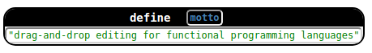

# Language Guide

This is a guide to adding support for a new language to CodeMirror-Blocks
(CMB). The code in each section is type-checked against the current API, and
the [`lambda`](../packages/codemirror-blocks/src/languages/lambda/) and
[`wescheme`](../packages/wescheme-blocks/src/) languages in this repository are
complete examples to read alongside it.

## Logistics

A language module is a separate package that depends on `@bootstrapworld/codemirror-blocks`:

    npm install --save @bootstrapworld/codemirror-blocks

Your IDE must load CodeMirror 5 itself (it is a peer dependency). Everything
CMB exposes to language authors is exported from the package root:

    import {
      ASTNode, // the base class of all nodes
      Args, // drop targets for list fields (see "Rendering DropTargets")
      DT, // the DropTarget component, and friends
      Node, // the component every block starts with
      Nodes, // the core node types, and tools for defining new ones
      NodeSpec, // declares the fields of a node type
      Languages, // register your language
      Pretty, // the pretty-printing library
      PrimitiveGroup, // primitives shown in the toolbar
    } from "@bootstrapworld/codemirror-blocks";

Types such as `Pos` live in submodules, e.g. `@bootstrapworld/codemirror-blocks/lib/ast`.

## Adding a Language

Here is the shape of a complete language module. The rest of this guide fills in
each step:

```tsx
import React from "react";
import {
  ASTNode,
  Args,
  Languages,
  Node,
  Nodes,
  NodeSpec as Spec,
  Pretty as P,
} from "@bootstrapworld/codemirror-blocks";
import type { Pos } from "@bootstrapworld/codemirror-blocks/lib/ast";

// 1. Declare the node types of your language. Start from the core ones...
const MyLangAST = Nodes.createASTSpec({
  ...Nodes.CoreAST.config,
  // ...and add your own, by listing the fields of each
  whenExpr: Spec.nodeSpec([Spec.required("test"), Spec.list("body")]),
});

// 2. Write a constructor function for each new node type
export function When(
  from: Pos,
  to: Pos,
  test: ASTNode,
  body: ASTNode[],
  options = {}
) {
  return MyLangAST.makeNode({
    from,
    to,
    type: "whenExpr",
    fields: { test, body },
    options,
    pretty: (node) =>
      P.standardSexpr("when", [node.fields.test, ...node.fields.body]),
    render(props) {
      return (
        <Node {...props}>
          <span className="blocks-operator">when</span>
          {props.node.fields.test.reactElement()}
          <Args field="body">{props.node.fields.body}</Args>
        </Node>
      );
    },
    longDescription: (node, level) =>
      `a when expression: when ${node.fields.test.describe(level)}`,
  });
}

// 3. Write a parser that produces an array of root nodes...
function parse(code: string): ASTNode[] {
  // ...(parse `code` and build nodes using When(), Nodes.Literal(), etc.)
  return [];
}

// 4. ...and tell CMB about your language
export default Languages.addLanguage({
  id: "mylang",
  name: "My Language",
  description: "An example language",
  parse,
});
```

`addLanguage` takes an object with these fields:

- `id` is a short, unique, alphanumeric identifier. It becomes part of the
  editor's CSS class (`blocks-language-<id>`), and is how an `AST` finds its
  language again.
- `name` is a human-facing name for the language.
- `description` is optional, and describes the language.
- `parse(code: string): ASTNode[]` is the parser, described in the next
  section.
- `getExceptionMessage(e: unknown): string | Error` is optional. It turns
  whatever `parse` threw into something to show the user. The default is
  `String(e)`.
- `primitivesFn(): PrimitiveGroup` is optional. It supplies the primitives shown
  in the toolbar. Use `PrimitiveGroup.fromConfig(name, config)` to build one
  from a plain description (see `wescheme-blocks/src/primitives-config.ts`).
  If you supply it, also supply `getASTNodeForPrimitive` and
  `getLiteralNodeForPrimitive`, which turn a primitive into the block that is
  dropped into the editor.

You will also want a [`less`](http://lesscss.org/) style file, loaded with
`require("./style.less")` from your module. Follow the
[stylesheet guide](stylesheet.md) to style your blocks.

## Defining the Parser

`parse(code)` receives the source code of a program, as a string with lines
separated by `\n`, and must return an array of top-level `ASTNode`s in source
order. (`addLanguage` wraps the result in an `AST` for you.) If the code can't
be parsed, throw: CMB refuses to switch to block mode and shows the message from
`getExceptionMessage`.

Every node is given a source location range (a `from` and a `to`, in
CodeMirror's `{line, ch}` format) when it is constructed. The ranges must obey
these rules:

1. The ranges must be well-formed: for each node, `node.from <= node.to`. (By
   `A <= B`, we mean that `A` comes before `B` in the document: either it's on
   an earlier line, or it's on the same line but to the left, or it's at exactly
   the same location.)
2. The range of a parent node must encompass the ranges of its children. (I.e.,
   `parent.from <= child.from` and `child.to <= parent.to` for each child.)
3. The ranges of a node's children must be non-overlapping and in-order. (I.e.,
   if `child1` comes before `child2` in the AST, then `child1.to <= child2.from`.)

Every node also takes an `options` object. The ones you will use are:

- `ariaLabel`: a short description of the node, read by screen readers when
  the node is deeply nested (see "Speaking out Loud").
- `comment`: a `Nodes.Comment` for the comment that goes with this node. Your
  parser is responsible for pairing comments with the nodes they describe.
- `isNotEditable`: prevents the node from being edited.

The core node types (`Nodes.Literal`, `Nodes.FunctionApp`,
`Nodes.VariableDefinition`, `Nodes.IfExpression`, ...) are constructor
functions with the same `(from, to, ...fields, options)` shape. For example:

```ts
Nodes.VariableDefinition(from, to, name, body, {
  ariaLabel: "motto: a value definition",
  comment,
});
```

## Defining Node Types

Let's see how a node type is defined, using variable definitions as the
example. As text, these nodes look like this:

    (define motto "drag-and-drop editing for functional programming languages")

and as blocks, they look like this:



The core definition lives in
[`nodes.tsx`](../packages/codemirror-blocks/src/nodes.tsx). We'll walk through
the pieces, using the `When` node from above.

### Fields and the Spec

Nodes are plain `ASTNode` instances, not subclasses. What distinguishes one
node type from another is its **spec**, which declares the type of each of its
fields:

```ts
const MyLangAST = Nodes.createASTSpec({
  ...Nodes.CoreAST.config,
  whenExpr: Spec.nodeSpec([Spec.required("test"), Spec.list("body")]),
});
```

There are four kinds of field specs:

- `Spec.required`: the field stores an `ASTNode`, and it must always be present.
- `Spec.optional`: the field stores either an `ASTNode`, or `null`.
- `Spec.list`: the field stores an array of `ASTNode`s.
- `Spec.value`: the field stores any other kind of value, that does not contain
  any `ASTNode`s. Give it its type with, e.g., `Spec.value<string, "form">("form")`.

Declaring all of a node's field types up front like this allows CodeMirrorBlocks
to automatically compute things like the hash of a node, and TypeScript to know
the type of `node.fields`. It also allows the block editor to behave
intelligently: for example, if you delete a required block it will be replaced by
a "blank" block (shown as `?` by default), but if you delete a block stored in a
`Spec.list` field, that will remove the list element.

Failing to list all the fields of a node can leave the editor in an unstable
state, so `makeNode` validates a node against its spec when it is created.

### Making Nodes

`MyLangAST.makeNode({...})` creates a node of one of the types in the spec. It
takes the location, the type name, the fields, the options, and three
functions: `pretty`, `render` and (optionally) `longDescription`. We write a
constructor function around it, like `When` above, so that parsers can create
nodes without repeating all of that.

The type name (`"whenExpr"`) shows up in console errors, and in CSS (as the
class `blocks-whenExpr`). It is also available as `node.type`; use
`MyLangAST.isNodeOfType(node, "whenExpr")` to narrow the type of a node you are
given.

### Speaking out Loud

The `longDescription(node, level)` function describes the node aloud for a
screen reader. It should return a string:

```ts
longDescription: (node, level) =>
  `a when expression: when ${node.fields.test.describe(level)}`,
```

Most of the time, the description should include descriptions of the node's
children. _Do not use `child.longDescription(...)` for this!_ If you do, and a
user asks a 1000-line function to describe itself, it will read the entire
function recursively, which is too much detail.

Instead, use `ASTNode.describe(level)`. This will automatically use a shorter
description for deeply nested nodes. (Specifically, it will use
`node.options.ariaLabel`.)

### Rendering as Text

Nodes need to know how to render themselves as text. Furthermore, the _best_
way to render something as text depends on the width of the screen (narrow
screens should cause things to wrap more easily), so we can't simply use a
`toString()` method. Instead, nodes have a `pretty` function that returns a
pretty-printing "`Doc`" that can adapt itself intelligently to different screen
widths.

The `When` node is an s-expression, so it can just use the pretty printing
library's built-in support for displaying various kinds of s-expressions:

```ts
pretty: (node) =>
  P.standardSexpr("when", [node.fields.test, ...node.fields.body]),
```

Whatever `pretty` produces is what the text editor shows, and what is parsed
again when you switch modes, so **the text must parse back to the same
tree**. If your syntax isn't an s-expression, build a `Doc` with `P.horz`,
`P.vert`, `P.sepBy`, and friends. The lambda language's
[`ast.tsx`](../packages/codemirror-blocks/src/languages/lambda/ast.tsx) has
infix operators, calls, and blocks as examples.

To learn how to write `pretty` in general, see the documentation for the
[pretty printing library](https://github.com/brownplt/pretty-fast-pretty-printer).
It is exported from `@bootstrapworld/codemirror-blocks` as `Pretty`, so you don't need to
declare it as a dependency.

### Rendering as a Block

Finally, the node needs to know how to render itself as a block. This is
accomplished by a `render(props)` function that returns a React element:

```tsx
render(props) {
  return (
    <Node {...props}>
      <span className="blocks-operator">when</span>
      {props.node.fields.test.reactElement()}
      <Args field="body">{props.node.fields.body}</Args>
    </Node>
  );
},
```

This is a [React function component](https://react.dev/learn/your-first-component).
Read the React documentation for an overview of what components are and how
you can define them. Beyond that, here are some things you should know about
defining CodeMirror-Blocks components:

- This function was written using [JSX](https://react.dev/learn/writing-markup-with-jsx),
  which is what allows the HTML-like syntax like `<span> ... </span>`.
- All blocks should start with a `<Node>...</Node>` element. Pass it the props
  that `render` was given (using the `{...props}` syntax), which include the
  `node`.
- The `blocks-operator` span makes the black bar at the top of the block, and
  the `blocks-args` span makes the section at the bottom. For more options, see
  the [stylesheet guide](stylesheet.md).
- To render a child that is also an `ASTNode`, use `child.reactElement()`. This
  produces a React element. If you wish to pass it any `props`, you may pass
  them in as an object: `child.reactElement({prop: value})`.

#### Rendering DropTargets

If you've played around with the editor, you will have noticed "drop targets":
the small squares between nodes that you can drag blocks onto, or edit to insert
a new child. When defining your blocks, you should include ample drop targets to
make them easy to edit. There are two ways to get these.

Most of the time, you should use `Args`. The syntax is
`<Args field="FIELDNAME">{elts}</Args>`, which will intersperse drop targets
horizontally among `elts` (which should be an array of nodes, or elements).
"FIELDNAME" is the name of the field containing `elts`, which must be declared as
type `Spec.list`.

However, if you want to put drop targets in a more interesting arrangement than
`Args` gives you, you have a second option: you can use `DT.DropTarget`s
directly. Simply construct them with `<DT.DropTarget field="FIELDNAME"/>`
anywhere in your node. Every drop target must declare a `field`, corresponding
to one of the list fields of the node, so that CMB knows what part of the node
is modified when the drop target is edited.

---

That's it! We've fully defined the `When` node type.

## Testing a Language

CMB's own tests, and those of the language packages in this repository, use the
helpers in
[`toolkit/test-utils.tsx`](../packages/codemirror-blocks/src/toolkit/test-utils.tsx)
(imported as `@bootstrapworld/codemirror-blocks/lib/toolkit/test-utils`). They build on the
private `@bootstrapworld/cmb-toolkit` package, so they are only available inside
this repository's workspace. `mountCMB(language)` renders an editor into the test DOM, in block mode, and
returns `{cmb, store}`; the API calls on `cmb` are wrapped in React's `act()`, so
the DOM is up to date after each one. The event helpers in the same module
(`click`, `keyDown`, `insertText`, ...) simulate user input.

Two things are worth testing in every language:

1. The parser, directly: build an AST with `language.buildAST(code)` and check the
   `type` and `fields` of the nodes, **especially** each node's `options.ariaLabel`
   and `longDescription` output.
2. Round trips: `language.buildAST(code).toString()` should parse back to the
   same tree. The lambda language's
   [`lambda-language-test.ts`](../packages/codemirror-blocks/spec/languages/lambda/lambda-language-test.ts)
   does this for a list of programs.
