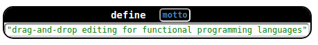

# Language Guide

This is a guide to adding support for a new language to CodeMirror-Blocks
(CMB). The code in each section is type-checked against the current API, and
the [`lambda`](../packages/codemirror-blocks/src/languages/lambda/) and
[`wescheme`](../packages/codemirror-blocks/src/languages/wescheme/) languages in this repository are
complete examples to read alongside it.

## Logistics

A language module is a separate package that depends on `@bootstrapworld/codemirror-blocks`:

    npm install --save @bootstrapworld/codemirror-blocks

Your IDE must load CodeMirror 5 itself (it is a peer dependency). Everything
CMB exposes to language authors is exported from the package root:

    import {
      ASTNode, // the base class of all nodes
      Args, // drop targets for list fields (see "Rendering DropTargets")
      DT, // the DropTarget component, and friends
      Node, // the component every block starts with
      Nodes, // the core node types, and tools for defining new ones
      NodeSpec, // declares the fields of a node type
      Languages, // register your language
      Pretty, // the pretty-printing library
      PrimitiveGroup, // primitives shown in the toolbar
    } from "@bootstrapworld/codemirror-blocks";

Types such as `Pos` live in submodules, e.g. `@bootstrapworld/codemirror-blocks/lib/ast`.

## Adding a Language

Here is the shape of a complete language module. The rest of this guide fills in
each step:

```tsx
import React from "react";
import {
  ASTNode,
  Args,
  Languages,
  Node,
  Nodes,
  NodeSpec as Spec,
  Pretty as P,
} from "@bootstrapworld/codemirror-blocks";
import type { Pos } from "@bootstrapworld/codemirror-blocks/lib/ast";

// 1. Declare the node types of your language. Start from the core ones...
const MyLangAST = Nodes.createASTSpec({
  ...Nodes.CoreAST.config,
  // ...and add your own, by listing the fields of each
  whenExpr: Spec.nodeSpec([Spec.required("test"), Spec.list("body")]),
});

// 2. Write a constructor function for each new node type
export function When(
  from: Pos,
  to: Pos,
  test: ASTNode,
  body: ASTNode[],
  options = {}
) {
  return MyLangAST.makeNode({
    from,
    to,
    type: "whenExpr",
    fields: { test, body },
    options,
    pretty: (node) =>
      P.standardSexpr("when", [node.fields.test, ...node.fields.body]),
    render(props) {
      return (
        <Node {...props}>
          <span className="blocks-operator">when</span>
          {props.node.fields.test.reactElement()}
          <Args field="body">{props.node.fields.body}</Args>
        </Node>
      );
    },
    longDescription: (node, level) =>
      `a when expression: when ${node.fields.test.describe(level)}`,
  });
}

// 3. Write a parser that produces an array of root nodes...
function parse(code: string): ASTNode[] {
  // ...(parse `code` and build nodes using When(), Nodes.Literal(), etc.)
  return [];
}

// 4. ...and tell CMB about your language
export default Languages.addLanguage({
  id: "mylang",
  name: "My Language",
  description: "An example language",
  parse,
});
```

`addLanguage` takes an object with these fields:

- `id` is a short, unique, alphanumeric identifier. It becomes part of the
  editor's CSS class (`blocks-language-<id>`), and is how an `AST` finds its
  language again.
- `name` is a human-facing name for the language.
- `description` is optional, and describes the language.
- `parse(code: string): ASTNode[]` is the parser, described in the next
  section.
- `blockComment: { open, close }` is optional. It says how the language writes
  a block comment (`{ open: "#|", close: "|#" }` for Scheme). If it is given,
  Shift-Ctrl-] adds or edits a comment on the focused block, and the comment
  is written this way, so the language's `parse` has to read it back as a
  comment and attach it to the block after it (`Comment(from, to, text,
{ blockComment })` makes the node). Without it the command says that the
  language has no comments.
- `getExceptionMessage(e: unknown): string | Error` is optional. It turns
  whatever `parse` threw into something to show the user. The default is
  `String(e)`.
- `primitivesFn(): PrimitiveGroup` is optional. It supplies the primitives shown
  in the toolbar. Use `PrimitiveGroup.fromConfig(name, config)` to build one
  from a plain description (see `codemirror-blocks/src/languages/wescheme/primitives-config.ts`).
  If you supply it, also supply `getASTNodeForPrimitive` and
  `getLiteralNodeForPrimitive`, which turn a primitive into the block that is
  dropped into the editor.

You will also want a [`less`](http://lesscss.org/) style file, loaded with
`require("./style.less")` from your module. Follow the
[stylesheet guide](stylesheet.md) to style your blocks.

## Defining the Parser

`parse(code)` receives the source code of a program, as a string with lines
separated by `\n`, and must return an array of top-level `ASTNode`s in source
order. (`addLanguage` wraps the result in an `AST` for you.) If the code can't
be parsed, throw: CMB refuses to switch to block mode and shows the message from
`getExceptionMessage`.

Every node is given a source location range (a `from` and a `to`, in
CodeMirror's `{line, ch}` format) when it is constructed. The ranges must obey
these rules:

1. The ranges must be well-formed: for each node, `node.from <= node.to`. (By
   `A <= B`, we mean that `A` comes before `B` in the document: either it's on
   an earlier line, or it's on the same line but to the left, or it's at exactly
   the same location.)
2. The range of a parent node must encompass the ranges of its children. (I.e.,
   `parent.from <= child.from` and `child.to <= parent.to` for each child.)
3. The ranges of a node's children must be non-overlapping and in-order. (I.e.,
   if `child1` comes before `child2` in the AST, then `child1.to <= child2.from`.)

Every node also takes an `options` object. The ones you will use are:

- `ariaLabel`: a short description of the node, read by screen readers when
  the node is deeply nested (see "Speaking out Loud").
- `comment`: a `Nodes.Comment` for the comment that goes with this node. Your
  parser is responsible for pairing comments with the nodes they describe (see
  below for how to leave that to the editor).
- `isNotEditable`: prevents the node from being edited.

The core node types (`Nodes.Literal`, `Nodes.FunctionApp`,
`Nodes.VariableDefinition`, `Nodes.IfExpression`, ...) are made as every node
is, with `(from, to, fields, options)`, where `fields` is an object with the
fields of the node by name (see `defineNode`, below). For example:

```ts
Nodes.VariableDefinition(
  from,
  to,
  { name, body },
  {
    ariaLabel: "motto: a value definition",
    comment,
  }
);
Nodes.Literal(from, to, { value: "42", dataType: "number" });
```

### Comments

**A language brings a parser that handles its comments.** Your reader is the one
that knows what is a comment (and what only looks like one, a `;` in a text), so
it reads each comment it skips and reports it, as the range it covers in the
code. Then give `attachComments` the root nodes it made, and those comments:

```ts
import { attachComments } from "@bootstrapworld/codemirror-blocks/lib/orphans";

parse(code) {
  const { roots, comments } = readNodes(code); // every node has its range
  // comments: [{ from, to }, ...], offsets in `code` (or positions); a `text`
  // can be given, if the reader knows it (else it is the source, less its marks)
  return attachComments(code, roots, {
    blockComment: { open: "/*", close: "*/" }, // how the editor writes one back
    comments,
  });
}
```

A parser that skips a comment without reporting it loses it. To test that
yours does not, give `commentProblems` (in `toolkit/comment-conformance`) some
programs with a `@@` wherever a comment may be put, and how your language
writes one: it returns what is wrong (a comment that is lost or printed twice,
a printing that does not parse back the same), and `[]` if nothing is.

Every language pairs its comments with its nodes by the same rules, so that a
comment means the same thing in all of them:

- a comment **after code on its line** (`(f x) ; c`) goes with that code (the
  last node of its list to end before it);
- a comment **above a node** (on the line just above it, or before it on its
  line) goes with the node;
- a comment **at the end of the program**, on the line after the last node, goes
  with the last node;
- any other comment is a **block of its own**, among the elements of the nearest
  list around it that was declared with `Spec.list(name, { orphans: true })`, or,
  where there is none, with the node beside it.

A comment that goes with a node is its `options.comment`, and **the editor prints
it** (above the node if it came before it; beside it if it came after on the same
line and fits, and above if not; an end-of-program comment beside it, or below):
a node's `pretty` does not print its comment, and should not.

The rules are a table, `COMMENT_RULES` (in `commentRules.ts`, with what each
setting means: `afterCode`, `above`, `maxLinesAbove`, `atEnd`, `printAfter`). A
language that needs something else says so once, in its definition, giving only
the settings it changes; they are used when its `parse` pairs the comments and
when its nodes are printed:

```ts
addLanguage({
  id: "mine",
  // ...
  commentRules: { afterCode: "next", maxLinesAbove: 2 },
});
```

(A call of `attachComments` can also give `rules` of its own, which win.)

If your language has one node that holds the whole program (as lambda's `prog`)
and not one root for each thing in it, pass it as `topLevel`, so that the end of
the program is the end of its list.

## Defining Node Types

Let's see how a node type is defined, using variable definitions as the
example. As text, these nodes look like this:

    (define motto "drag-and-drop editing for functional programming languages")

and as blocks, they look like this:



The core definition lives in
[`nodes.tsx`](../packages/codemirror-blocks/src/nodes.tsx). We'll walk through
the pieces, using the `When` node from above.

### Fields and the Spec

Nodes are plain `ASTNode` instances, not subclasses. What distinguishes one
node type from another is its **spec**, which declares the type of each of its
fields:

```ts
const MyLangAST = Nodes.createASTSpec({
  ...Nodes.CoreAST.config,
  whenExpr: Spec.nodeSpec([Spec.required("test"), Spec.list("body")]),
});
```

There are four kinds of field specs:

- `Spec.required`: the field stores an `ASTNode`, and it must always be present.
- `Spec.optional`: the field stores either an `ASTNode`, or nothing (`null`, or `undefined`: a field that is left out is the same).
- `Spec.list`: the field stores an array of `ASTNode`s.
- `Spec.value`: the field stores any other kind of value, that does not contain
  any `ASTNode`s. Give it its type with, e.g., `Spec.value<string, "form">("form")`.

Declaring all of a node's field types up front like this allows CodeMirrorBlocks
to automatically compute things like the hash of a node, and TypeScript to know
the type of `node.fields`. It also allows the block editor to behave
intelligently: for example, if you delete a required block it will be replaced by
a "blank" block (shown as `?` by default), but if you delete a block stored in a
`Spec.list` field, that will remove the list element.

Failing to list all the fields of a node can leave the editor in an unstable
state, so `makeNode` validates a node against its spec when it is created.

### Making Nodes

`MyLangAST.makeNode({...})` creates a node of one of the types in the spec. It
takes the location, the type name, the fields, the options, and three
functions: `pretty`, `render` and (optionally) `longDescription`. We write a
constructor function around it, like `When` above, so that parsers can create
nodes without repeating all of that.

The type name (`"whenExpr"`) shows up in console errors, and in CSS (as the
class `blocks-whenExpr`). It is also available as `node.type`; use
`MyLangAST.isNodeOfType(node, "whenExpr")` to narrow the type of a node you are
given.

#### A kind of node in one place: `defineNode`

Writing the spec, the constructor and `makeNode` says the fields of a node three
times. `defineNode` says them once, and gives back the constructor:

```tsx
import { defineNode, field } from "@bootstrapworld/codemirror-blocks";

const When = defineNode({
  type: "whenExpr",
  label: "when expression", // what it is called, to people and screenreaders
  fields: {
    test: field.required(), // a node
    otherwise: field.optional(), // a node, or null, or left out
    body: field.list({ orphans: true }), // nodes (and comments that go with none)
    id: field.value<number>(), // anything that is not a node
  },
  pretty: (node) =>
    P.standardSexpr("when", [node.fields.test, ...node.fields.body]),
  render: (props) => <Node {...props}>...</Node>,
  // optional: longDescription, and ariaLabel (made from the node, so from its label)
});

When(from, to, { test, otherwise: null, body: [], id: 1 }, options);
```

The fields of `node` are typed from the declaration (`node.fields.body` is an
array of nodes), and so are the fields given to the constructor. The comment that
goes with a node is printed for you (above it, or beside it), whether `pretty`
returns a `Doc` or text. `When.type` and `When.spec` are there for what needs
them.

### Speaking out Loud

The `longDescription(node, level)` function describes the node aloud for a
screen reader. It should return a string:

```ts
longDescription: (node, level) =>
  `a when expression: when ${node.fields.test.describe(level)}`,
```

Most of the time, the description should include descriptions of the node's
children. _Do not use `child.longDescription(...)` for this!_ If you do, and a
user asks a 1000-line function to describe itself, it will read the entire
function recursively, which is too much detail.

Instead, use `ASTNode.describe(level)`. This will automatically use a shorter
description for deeply nested nodes. (Specifically, it will use
`node.options.ariaLabel`.)

To say what a list of children is made of, without naming each one, use
`describeKinds(nodes)`: it counts them by kind, by what each kind's `label` and
`pluralLabel` say, and reads as part of a sentence:

```ts
longDescription: (node) =>
  `a when expression, with ${describeKinds(node.fields.body)}`,
// "a when expression, with 2 definitions, 1 call, and 3 literals"
```

A comment that goes with no node is left out unless you ask for it
(`describeKinds(nodes, { orphans: "count" })`, which is what the editor says of
the top of a program when it opens it as blocks). It says "nothing" for no nodes.

### Rendering as Text

Nodes need to know how to render themselves as text. Furthermore, the _best_
way to render something as text depends on the width of the screen (narrow
screens should cause things to wrap more easily), so we can't simply use a
`toString()` method. Instead, nodes have a `pretty` function that returns a
pretty-printing "`Doc`" that can adapt itself intelligently to different screen
widths.

The `When` node is an s-expression, so it can just use the pretty printing
library's built-in support for displaying various kinds of s-expressions:

```ts
pretty: (node) =>
  P.standardSexpr("when", [node.fields.test, ...node.fields.body]),
```

Whatever `pretty` produces is what the text editor shows, and what is parsed
again when you switch modes, so **the text must parse back to the same
tree**. If your syntax isn't an s-expression, build a `Doc` with `P.horz`,
`P.vert`, `P.sepBy`, and friends. The lambda language's
[`ast.tsx`](../packages/codemirror-blocks/src/languages/lambda/ast.tsx) has
infix operators, calls, and blocks as examples.

Two helpers (exported from the package) cover what `Pretty` makes awkward:

- `sexpr(head, parts)` prints `(head part part ...)` like `Pretty.standardSexpr`,
  but leaves out a part that is `null`, `undefined` or `false`, so a form with an
  optional child has no empty text where it is not there:
  `sexpr("let", [node.fields.name, node.fields.start])`.
- `formSexpr(keyword, header, bodies)` prints a form with any number of bodies,
  one to a line and indented, with the closing bracket after the last:
  `formSexpr("repeat", node.fields.times, node.fields.steps)` is
  `(repeat 3\n  (show 1)\n  (show 2))`. The `header` can be `null`.

If your language already has a printer of its own, `pretty` may return the text
itself instead of a `Doc`. The text is taken as laid out already (it is not
reflowed to fit the width, and keeps its own line breaks), and the node's
comment is printed above it, or beside it if it was beside it before:

```ts
pretty: (node) => myPrinter.print(node.fields.statement),
```

To learn how to write `pretty` in general, see the documentation for the
[pretty printing library](https://github.com/brownplt/pretty-fast-pretty-printer).
It is exported from `@bootstrapworld/codemirror-blocks` as `Pretty`, so you don't need to
declare it as a dependency.

### Rendering as a Block

Finally, the node needs to know how to render itself as a block. This is
accomplished by a `render(props)` function that returns a React element:

```tsx
render(props) {
  return (
    <Node {...props}>
      <span className="blocks-operator">when</span>
      {props.node.fields.test.reactElement()}
      <Args field="body">{props.node.fields.body}</Args>
    </Node>
  );
},
```

This is a [React function component](https://react.dev/learn/your-first-component).
Read the React documentation for an overview of what components are and how
you can define them. Beyond that, here are some things you should know about
defining CodeMirror-Blocks components:

- This function was written using [JSX](https://react.dev/learn/writing-markup-with-jsx),
  which is what allows the HTML-like syntax like `<span> ... </span>`.
- All blocks should start with a `<Node>...</Node>` element. Pass it the props
  that `render` was given (using the `{...props}` syntax), which include the
  `node`.
- The `blocks-operator` span makes the black bar at the top of the block, and
  the `blocks-args` span makes the section at the bottom. For more options, see
  the [stylesheet guide](stylesheet.md).
- To render a child that is also an `ASTNode`, use `child.reactElement()`. This
  produces a React element. If you wish to pass it any `props`, you may pass
  them in as an object: `child.reactElement({prop: value})`.

#### Reading the state of a block

Whether a block has focus, is selected, collapsed and so on is kept by the
editor, and shows as CSS classes. A component drawn inside a `<Node>` can read
it too, with the `useNodeState()` hook (exported from
`@bootstrapworld/codemirror-blocks`), without knowing anything about redux:

```tsx
const VariableName = ({ name }: { name: string }) => {
  const { focused } = useNodeState();
  return (
    <span>
      {name}
      {focused ? <ScopeList /> : null}
    </span>
  );
};

render: (props) => (
  <Node {...props}>
    <VariableName name={props.node.fields.value} />
  </Node>
);
```

It gives plain, read-only values: `focused` (the block is the active one),
`selected`, `collapsed`, `dragging` (it is being dragged), `over` (something
being dragged is over it), `errored` (an edit of it was refused), `editing` (its text is being edited) and
`inToolbar`. A component that calls it is drawn again only when one of these
changes for _its_ block. A hook can only be called by a component, so call it in
a component inside the `<Node>`, not in `render()` itself. (For hover, use the
CSS `:hover`; the editor does not keep it.)

While a block with `normallyEditable` is being edited, the edit box takes the
place of its children, so they are not drawn. To show something beside the box
then (the names in scope, say), give the `<Node>` an `editingHint`, which can
read `useNodeState()` too:

```tsx
<Node {...props} normallyEditable editingHint={<ScopeList />}>
  <VariableName name={props.node.fields.value} />
</Node>
```

#### Rendering DropTargets

If you've played around with the editor, you will have noticed "drop targets":
the small squares between nodes that you can drag blocks onto, or edit to insert
a new child. When defining your blocks, you should include ample drop targets to
make them easy to edit. There are two ways to get these.

Most of the time, you should use `Args`. The syntax is
`<Args field="FIELDNAME">{elts}</Args>`, which will intersperse drop targets
horizontally among `elts` (which should be an array of nodes, or elements).
"FIELDNAME" is the name of the field containing `elts`, which must be declared as
type `Spec.list`. `Args` draws no container of its own; give it a `className` to
have them in a `<span>` of that class (the editor's style lays the arguments of
a call out in `blocks-args`: `<Args className="blocks-args" field="args">`).

However, if you want to put drop targets in a more interesting arrangement than
`Args` gives you, you have a second option: you can use `DropTarget`s directly
(exported as `DT`). Every one says where it goes with two props:

- `field`: the list field of the node that a node dropped (or typed) there
  joins (or an empty `optional` field: see below);
- `index`: its place in that list. A drop target with `index={i}` inserts as
  element `i`, before the element that is there now, and the one after the last
  element has `index={list.length}`.

Where the drop target is in the page does not matter, so a layout can put it
anywhere (in a gutter, a footer, a nested container), and an empty list needs
only the target with `index={0}`:

```tsx
<ul>
  {listItems(statements).map(({ node, index, number }) => (
    <li key={index}>
      <DT field="statements" index={index} />
      <span className="line-number">{number}</span>
      {node.reactElement()}
    </li>
  ))}
</ul>
<DT field="statements" index={statements.length} />
```

The index counts every element of the array, **including orphan comments** if
the list can hold them. `listItems` gives each element its `index` and, for a
layout that shows numbers, its `number`, which skips the comments (`null` for
a comment). Do not number the rows from `index`, and do not leave the comments
out of the layout: the targets after one would get an index that is too low.
(A drop target says what is wrong, in the console, if its field is not a list
of the node or its index is not a whole number from 0 to the length of the list.)

An `optional` field that holds one node (the initializer of `let x;`, say) takes a
drop target when it is empty. It has no place in a list, so it takes no `index`:

```tsx
render: (props) => {
  const { symbol, init } = props.node.fields;
  return (
    <Node {...props}>
      let {symbol.reactElement()}
      {init ? <> = {init.reactElement()}</> : <DT field="init" />};
    </Node>
  );
};
```

A node dropped or typed there becomes the field. Draw the target only while the
field is empty (a filled one is replaced by dropping on its node), and leave the
`index` off: a drop target says what is wrong, in the console, if it is given an
index for an optional field, or none for a list.

---

That's it! We've fully defined the `When` node type.

## Testing a Language

CMB's own tests, and those of the language packages in this repository, use the
helpers in
[`toolkit/test-utils.tsx`](../packages/codemirror-blocks/src/toolkit/test-utils.tsx)
(imported as `@bootstrapworld/codemirror-blocks/lib/toolkit/test-utils`). They build on the
private `@bootstrapworld/cmb-toolkit` package, so they are only available inside
this repository's workspace. `mountCMB(language)` renders an editor into the test DOM, in block mode, and
returns `{cmb, store}`; the API calls on `cmb` are wrapped in React's `act()`, so
the DOM is up to date after each one. The event helpers in the same module
(`click`, `keyDown`, `insertText`, ...) simulate user input.

Two things are worth testing in every language:

1. The parser, directly: build an AST with `language.buildAST(code)` and check the
   `type` and `fields` of the nodes, **especially** each node's `options.ariaLabel`
   and `longDescription` output.
2. Round trips: `language.buildAST(code).toString()` should parse back to the
   same tree. The lambda language's
   [`lambda-language-test.ts`](../packages/codemirror-blocks/spec/languages/lambda/lambda-language-test.ts)
   does this for a list of programs.
