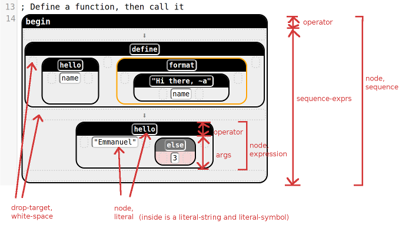

# Stylesheet Guide

This is a brief overview of how to make your language's
[less-css](http://lesscss.org/) style file.

Your style file should look like this:

    .blocks-language-MY_LANG {
      @border-radius: 5px;
      OTHER_PARAMS
      ...
      @import "default-style.less"; // use appropriate path to this file

      SET_STYLES
      ...
    }

To load the stylesheets, see the [last section](#loading-the-stylesheets).

The rest of this documentation has two sections, describing (i) the
parameters you can override, and (ii) the css classes you can tweak the
style of.

## Parameters

`default-style.less` can take a number of parameters (more
specifically `less` variables). Here they are, together with their
defaults. To set these, define them _after_ importing
`default-style.less`. Parameters you do not set will use their default.

### Sizes

- **border-radius**: The radius of the curve at the edges of blocks.
  Zero would make them rectangles.

        @border-radius: 5px;

- **large-border-radius**: An extra-large curve radius used for certain blocks.

        @large-border-radius: 15px;

- **border-width**: The width of the border of a block.

        @border-width: 1px;

### Colors

- **comment-color**: The foreground color of comments (i.e., the color
  of their text).

        @comment-color: #ddd;

- **comment-background-color**: The background color of comments.

        @comment-background-color: #444;

- **border-color**: The default border color for blocks.

        @border-color: block;

- **focus-border-color**: The border color for the block you are
  currently focused on. (When you navigate with the arrow keys, you
  are changing which block is focused.)

        @focus-border-color: orange;

- **error-border-color**: The border color for a block containing an
  error, such as [FILL].

        @error-border-color: red;

- **hover-border-color**: The border color for a block being hovered over
  with the mouse cursor.

        @hover-border-color: rgba(255, 165, 0, 0.3);

- **drag-drop-background-color**: When dragging a block over an empty
  spot, this color highlights this potential drop location.

        @hover-drop-background-color: lightblue;

- **drag-replace-background-color**: When dragging a block over a spot
  that's taken, this color highlights this potential replacement.

        @hover-replace-background-color: red;

## CSS Classes

Here is a list of the css classes you may want to change the
appearance of. There are a few more obscure classes in
`src/less/default-style.less`, but you would only need to modify
those under unusual circumstances.

### Block Classes

Every block has the `blocks-node` css class:

- **blocks-node**: _Any_ block

- **blocks-node[aria-selected^="true"]**: A block that is currently
  selected.

- **blocks-node[aria-expanded="false"]**: A folded/collapsed block

In addition, every `blocks-node` also has a more specific class that
says what kind of node it is. The options for this more specific class
are:

- **blocks-literal**: A block containing literal data, such as a
  string or number.

- **blocks-sequence**: A vertical sequence of blocks, such as used by
  Scheme's `begin`.

- **blocks-TYPE**: A block of the given type, where TYPE is the `type` of the
  node. The core node types have the classes `blocks-functionApp`,
  `blocks-variableDefinition`, `blocks-functionDefinition`,
  `blocks-structDefinition`, `blocks-lambdaExpression`, `blocks-ifExpression`,
  `blocks-condExpression`, `blocks-condClause`, `blocks-identifierList`,
  `blocks-loop`, `blocks-binaryOperation`, `blocks-unaryOperation`,
  `blocks-assignment`, `blocks-if`, `blocks-conditional`, `blocks-conditionalBranch`,
  `blocks-return` and `blocks-comment`. Your language defines the rest: a node created with
  `type: "whenExpr"` gets the class `blocks-whenExpr`.

- **blocks-loop-header** and **blocks-loop-body**: the parts of a
  `blocks-loop`: what the kind of loop needs before its steps (drawn in a row)
  and the steps (drawn in a column).

- **blocks-conditional-branches**, **blocks-conditional-else** and
  **blocks-conditional-body**: the parts of a `blocks-conditional` and of a
  `blocks-conditionalBranch`: the branches (a column), the else, and the steps
  of a branch or of the else (a column).

- **blocks-if-else** and **blocks-not-live**: the else of a `blocks-if`, which
  has the second class (and is drawn faded) while it has no steps.

- **blocks-compound** and **blocks-value**: what a block that has
  `<Node variant="compound">` or `variant="value"` is drawn as, whatever its
  `type`: the first is a frame with a black bar at the top (a call, a
  definition), the second is a small pill (a name, a number). A language does not
  have to name its own kinds of node in its stylesheet to get them.

- **blocks-hint**: A chip for what a block says about its own state (see
  `useNodeState`, and `editingHint` of `<Node>`): give a `<span>` this class.

- **blocks-blank**: This represents a part of the program that hasn't been
  filled in yet.

- **blocks-unknown**: A block of unknown type.

Most typical blocks have two parts: an `operator` (the black bar up
top), and an `args` (the space below that contains its children):

- **operator**: The "head" of a node, shown by default in a black bar
  at the top of the block.

- **args**: The "children" of a node, shown by default in a light gray
  section at the bottom of the block.

If a node is a `blocks-sequence`, however, it contains a
`sequence-exprs` instead of an `args`:

- **sequence-exprs**: The "children" of a `blocks-sequence`. By
  default, these are shown with arrows between them.

And if a node is a literal, it instead contains a span with a more
specific css class, for that particular literal:

- **blocks-literal-TYPE**: A literal of type TYPE. This is contained
  _inside_ of a span of class `blocks-literal`. What TYPE can be is
  defined by your language.

Some blocks have spaces that you can drop a block onto. These spaces
have the css class `blocks-drop-target`, as well as `blocks-white-space`:

- **blocks-drop-target**: A spot that you can drag a block onto.

Here is a diagram showing most of the css classes. The classes are
written without the `blocks-` prefix.



<!--
  internal use
    .blocks-identifierList
    .blocks-editing
    .blocks-over-target
    .blocks-white-space
    .blocks-dragging
-->

### Other Classes

- **searchBox**: The box that pops up when you search with `/`.

## Drawing a language more than one way

Because the default style speaks of `blocks-compound` and `blocks-value`, and
not of one language's kinds of node, the same blocks can be drawn another way by
a stylesheet that changes those classes (and the few of the language's own), and
nothing else: the drop targets, selection, focus and the edit box stay the
default style's. Put the alternate rules under a class that the page sets:

```less
.look-storyboard .blocks-language-routine {
  .blocks-compound {
    border-left-width: 6px;
    background: white;
  }
  .blocks-operator {
    background: transparent;
    color: #555;
  }
}
```

Routine has a `storyboard` look (cards with a colored edge and an arrow between
the steps of a loop), and lambda a `maths` one (no frames, `f(x)` with its
brackets, `λ`). On the example page, `?look=storyboard` or `?look=maths` (or the
"Look" menu, for a language that has more than one) switches between them as the
page is open. This is a feature of the page: an application picks its look in its
own stylesheet.

## Loading the stylesheets

The editor's stylesheets are plain CSS, made when the package is built, so
that using it asks nothing of your bundler (no `less-loader`, `css-loader` or
`style-loader`). Load them with a `<link>`, or import them if your bundler
handles CSS:

```js
import "codemirror/lib/codemirror.css";
import "@bootstrapworld/codemirror-blocks/css/codemirror-blocks.css"; // the editor
import "@bootstrapworld/wescheme/css/wescheme.css"; // a language
```

`css/<id>.css` of the module of a language (`@bootstrapworld/wescheme/css/wescheme.css`)
is its style, which `cmb-build-css` made from its Less; a language's style
is written under its own class, so loading all of them does no harm. A language
of your own makes its CSS from its Less (`npx lessc style.less style.css`, or
your bundler's loader, if you have one) and loads it the same way. The Less
sources are in the package too (`@bootstrapworld/codemirror-blocks/less/default-style.less`, ...), if you want
to compile the default style with your own variables, as the
[beginning of this guide](#stylesheet-guide) does.

(`css/example-page.css` and `css/debug-page.css` of the editor are the styles of our
example pages, and of wescheme.org: page chrome, not part of the editor.)
